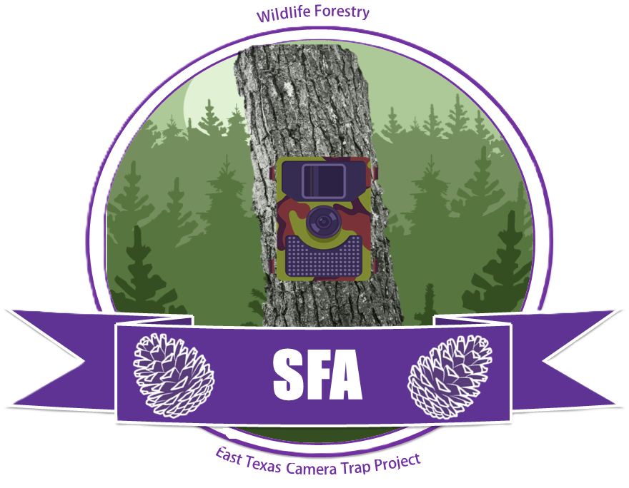

```{r}
#| label: setup-home
#| include: false

library(tibble)
library(leaflet)

study_sites <- tribble(
  ~site, ~year, ~status, ~lat, ~lon,
  "Winston 8 Tree Farm", 2024, "Completed", 31.52518, -94.72521,
  "Cherokee Ridge",      2025, "Completed", 31.54802, -94.92040,
  "Caddo Lake",          2026, "Active",    32.675715, -94.132160
)
```

:::::: hero
::::: hero-grid
::: hero-copy
# Long-Term Camera Trap Project

<p class="lead">

A shared hub for camera-trap surveys, field methods, sampling effort, and resources supporting undergraduate wildlife research at Stephen F. Austin State University.

</p>
:::

::: hero-logo

:::
:::::
::::::

## Projects

::::: portal-grid
::: portal-card
[Annual field project]{.status}

### Field Station – Bait Project

Camera-trap surveys conducted during the Wildlife Field Techniques field station. The project evaluates how different attractants influence wildlife detections.

[Explore Field Station surveys →](surveys/field-station/index.qmd)
:::

::: portal-card
[Expanding collection]{.status}

### Wildlife Techniques

Smaller camera-trap surveys conducted during Wildlife Techniques course to detect wildlife in urban areas.

*Section in development.*
:::
:::::

## Study sites

Our camera-trap work currently includes three East Texas study sites, with new locations added as surveys are completed.

::: map-wrap
```{r}
#| label: study-sites-map

icons <- awesomeIcons(
  icon = "camera",
  library = "fa",
  iconColor = "white",
  markerColor = "orange"
)

leaflet(study_sites, width = "100%", height = 430) |>
  
  addProviderTiles(
    providers$Esri.WorldImagery,
    group = "Satellite"
  ) |>
  
  addProviderTiles(
    providers$Esri.WorldTopoMap,
    group = "Topographic"
  ) |>
  
  addAwesomeMarkers(
    lng = ~lon,
    lat = ~lat,
    icon = icons,
    label = ~paste0(site, " (", year, ")"),
    popup = ~paste0(
      "<strong>", site, "</strong><br>",
      "<span style='color:#66736b;'>",
      year, " · ", status,
      "</span>" )
    
  ) |>
  
  addLayersControl(
    baseGroups = c(
      "Satellite",
      "Topographic"
    ),
    options = layersControlOptions(
      collapsed = TRUE
    )
  ) |>
  
  fitBounds(
    lng1 = min(study_sites$lon) - 0.20,
    lat1 = min(study_sites$lat) - 0.10,
    lng2 = max(study_sites$lon) + 0.20,
    lat2 = max(study_sites$lat) + 0.10
  )
```
:::

## Current Field Station surveys

::::: portal-grid
::: portal-card
[2024]{.status}

### Winston 8 Tree Farm

**4 triads · 12 stations · single-camera design**

Perfume, fish-based bait, and unbaited control treatments.

[View Winston 8 survey →](surveys/field-station/W8_2024.qmd)
:::

::: portal-card
[2025]{.status}

### Cherokee Ridge

**Paired ground cameras · separate canopy component**

Perfume, fish-based bait, and unbaited control treatments.

[View Cherokee Ridge survey →](surveys/field-station/CR_2025.qmd)
:::
:::::

## Resources

:::::: {.portal-grid .three}
::: portal-card
### Sort & identify

Species-identification resources and the workflow used to tag and organize camera-trap images in Timelapse.

*Resources coming soon.*
:::

::: portal-card
### Analyze in R

Training materials for students who want to move from processed camera-trap data to data summaries, visualization, and analysis in R.

🖥️ [*R course link*](https://gpandradep.github.io/R-CameraTrap-Workshop/)*.*
:::

::: portal-card
### Data & downloads

Standardized camtrapR outputs, survey metadata, and documentation describing which dataset should be used for different purposes.

*Download section coming soon.*
:::
::::::

## Using these data

::: soft-panel
Students should review the relevant project and survey pages before beginning an analysis. Sampling design, treatment structure, camera configuration, sampling duration, and data-processing decisions can differ among years and projects.
:::

For the Field Station bait project, analyses focused on attractant effects generally use the first **30 days of sampling at each station**. Other ecological analyses may use the **complete available survey period**. Each survey page reports sampling effort for both temporal scales.

## Data use and confidentiality

::: callout-warning
### Project information is for internal use

The information, data, maps, photographs, and other materials available through this website are intended for members and collaborators of the SFA Camera Trap Project.

Materials from this website should **not be used, reproduced, distributed, shared with individuals outside the project, or posted on social media without prior express authorization from the project coordinators**.

Access to these materials does not constitute permission to use the data for independent analyses, presentations, publications, reports, or other products. Students and collaborators should confirm appropriate data use and authorship expectations before beginning a project.
:::
