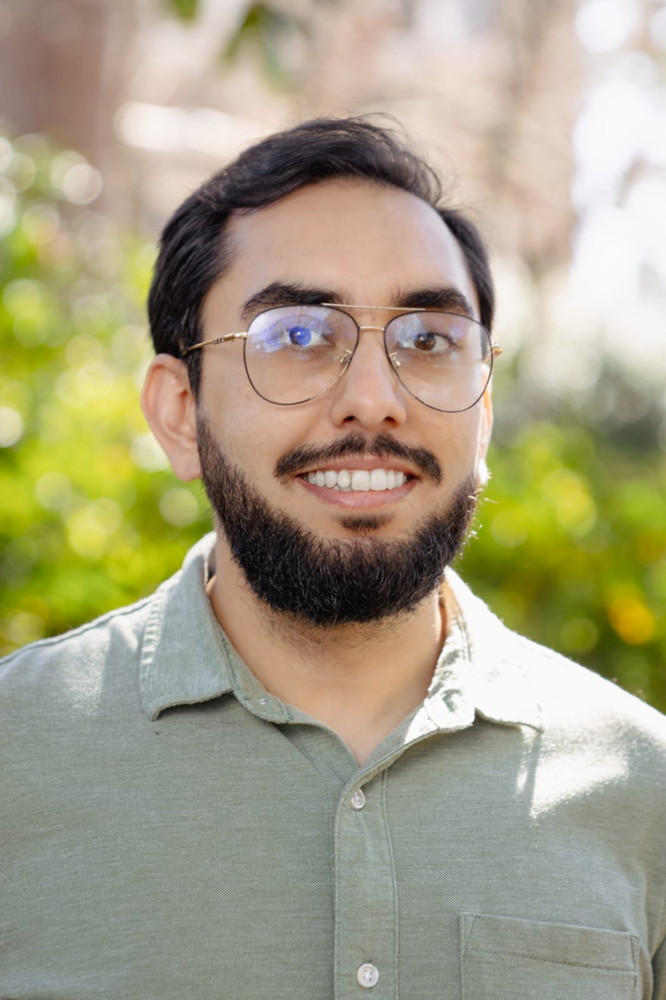

The SFA Camera Trap Project is a collaborative effort involving faculty, students, and field-course participants. Students contribute at different stages of the project, from deploying cameras and classifying images to developing independent research projects and presenting their work.

## Project leadership

::: {.people-grid}

::: {.person-card}

### Gabriel Andrade-Ponce

**Project lead** | **Postdoctoral Research Associate**

Camera-trap ecology, wildlife monitoring, data analysis, and student research mentoring.

Project leadership
Research
Mentoring

:::

::: {.person-card}

### Reuber Antoniazzi

**Project lead**| **Assistant Professor of Forest Wildlife Management**

Field coordination, wildlife techniques, camera deployment, and student mentoring.

Project leadership
Field work
Mentoring

:::

:::

## Student researchers

Students who have developed research questions, analyzed project data, or presented their work at scientific meetings will be highlighted here.

::: {.soft-panel}
Student profiles will be added as projects are completed. Profiles may include a photograph, research topic, poster or presentation, and links to related project materials.
:::

## Image classification team

Students currently contributing to image sorting, species identification, and database quality control will be listed here as the project grows.

## Field crew

Many students contribute to camera deployment and retrieval through field courses and project activities. Because this group can be large, field participants will be acknowledged here as a simple list rather than individual profiles.

*Names will be added by survey and year.*
