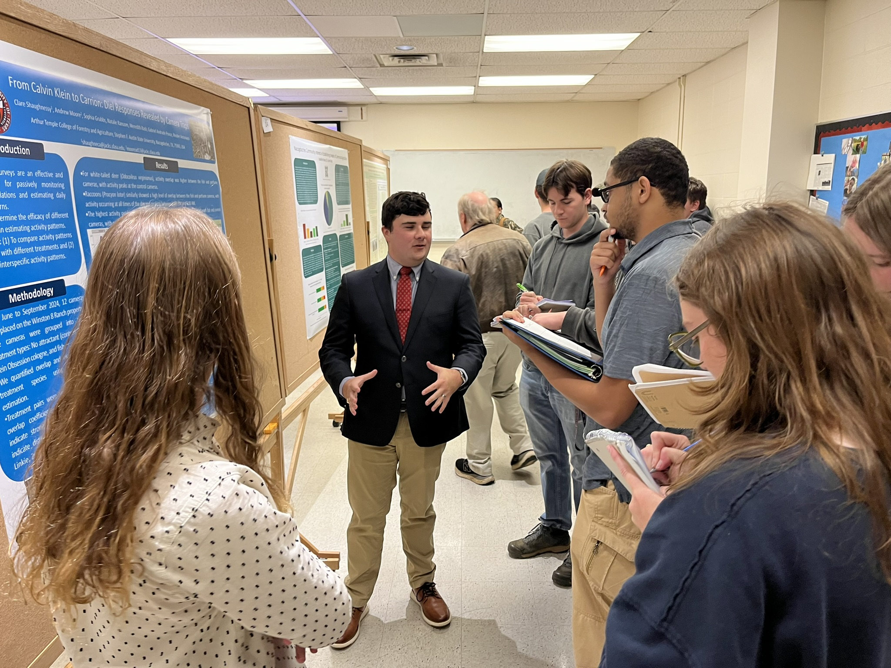
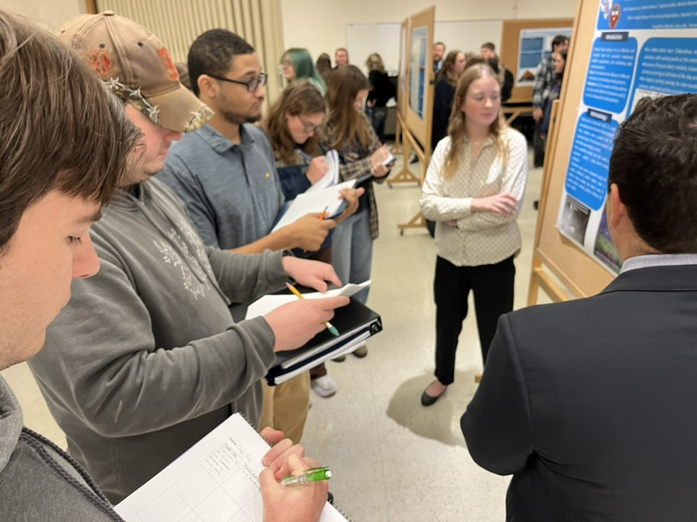
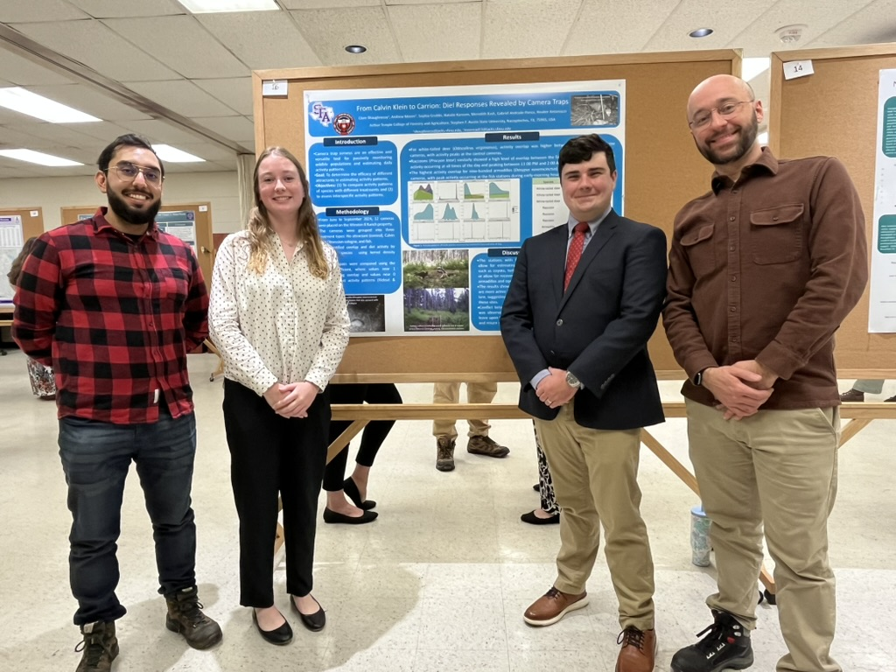
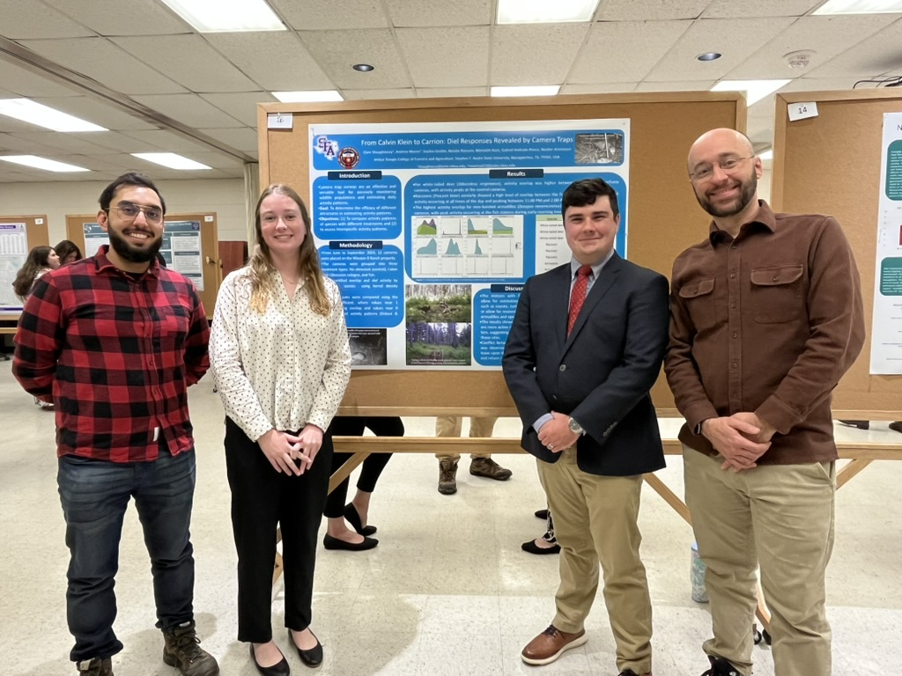

## *Effects of Bait Types on Camera Trap Detections of East Texas Animals*

## Authors

**Andrew Moore** <span class="presenter-mark" title="Student presenter">★</span>, Reuber Antoniazzi, **Clare Shaughnessy** <span class="presenter-mark" title="Student presenter">★</span>, Gabriel Andrade-Ponce, Sophia Grubbs, Natalie Ransom, Meredith Rash

<span class="presenter-note">★ Student presenter</span>

**Conference poster**

Presented at the [2026 TWS Chapter meeting](https://tctws.org/wp/wp-content/uploads/2026/02/TCTWS26-Long-Program-9.pdf) and the Undergraduate Research showcase Stephen F. Austin State University

[Download poster](Moore_Shaughnessy 2026.pdf)


```{=html}
<div class="research-photo-grid">

  

  

  

  

</div>

<div class="research-photo-caption">
Scenes from the 2026 TWS Chapter meeting and the undergraduate research presentation of this project.
</div>
```

## Abstract

Camera traps are helpful tools for passively monitoring patterns in animal activity and interactions. Different bait types can affect the foraging activity of animals. In this research, we evaluated the potential interactions among species using different baits, i.e., perfume Calvin Klein Obsession, a well-known attractant for wild cats, fish heads, and no baits (control). We analyzed the diel activity patterns of mammal communities in a managed Pineywood forest in East Texas. White-tailed deer (*Odocoileus virginianus*), raccoons (*Procyon lotor*), armadillos (*Dasypus novemcinctus*), and Virginia opossums (Didelphis virginiana) were recorded in each treatment at different times of the day, revealing that baits could be shaping their activity patterns. Armadillos and Virginia opossums were consistently observed at the fish stations shortly before Coyote (*Canis latrans*), potentially displaying avoidance behavior. Direct conflict between turkey vultures (*Cathartes aura*) and black vultures (*Coragyps atratus*) was observed while both species were attracted to and feeding at the fish head station. Turkey vultures showed a tendency to leave while the black vultures were present and return when the black vultures left, resulting in a bimodal curve for turkey vultures and a unimodal curve for black vultures when graphing activity patterns by species and treatment. Raccoons, which possess a dietary strategy of opportunistic omnivory, were not commonly observed at the fish stations, but were observed at the control station both early in the morning and at night, confirming their presence in the area. These observations highlight activity patterns such as predator-prey dynamics, opportunistic feeding, and competition in animal communities.

## Related survey

**Project:** [Field Station – Bait Project](../../../surveys/field-station/index.qmd)  
**Survey:** [Winston 8 — 2024](../../../surveys/field-station/W8_2024.qmd)