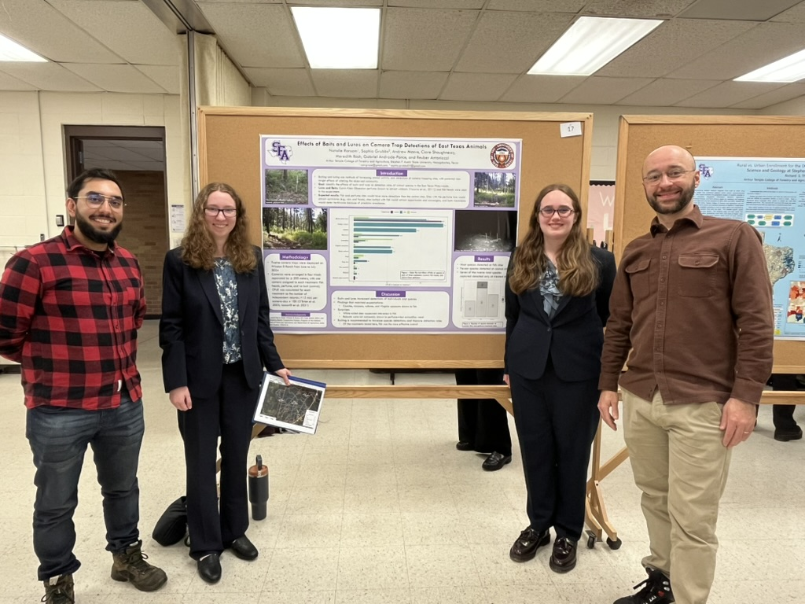
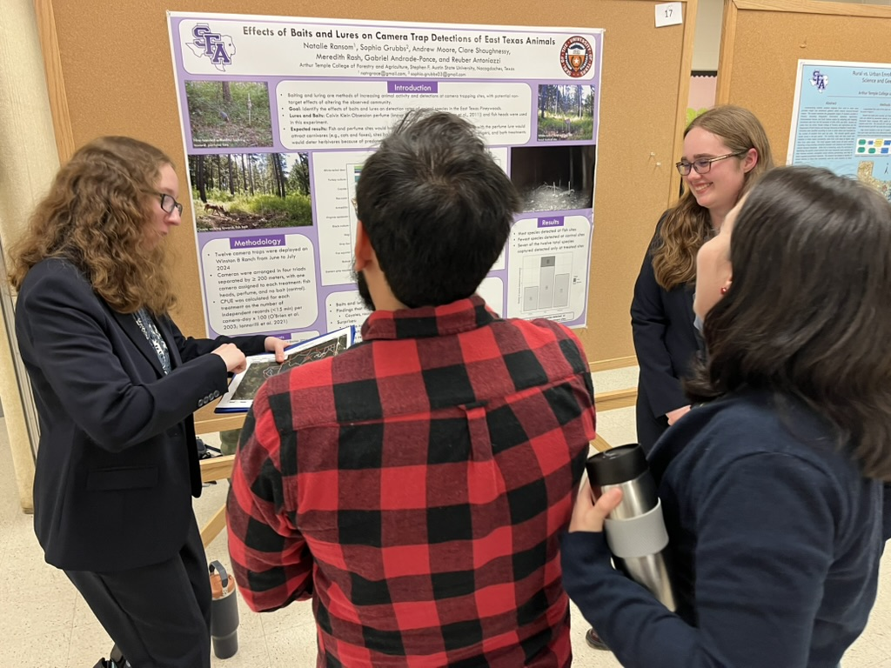
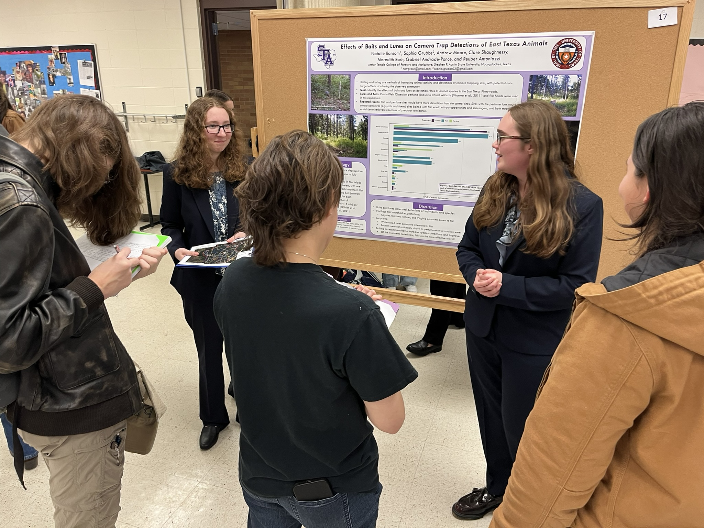
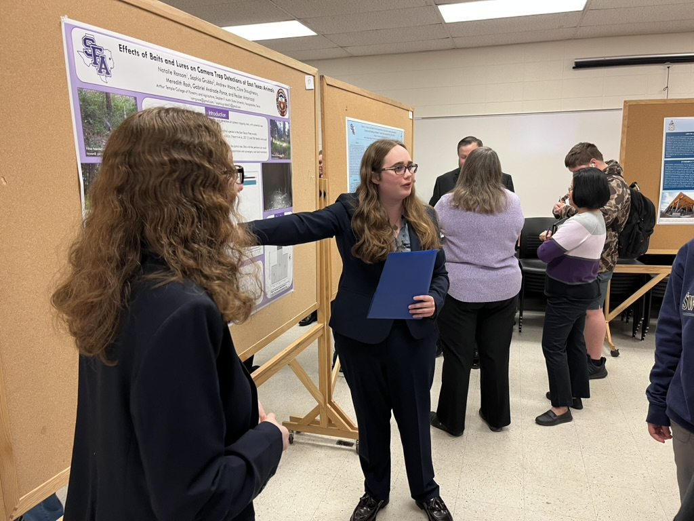

## *Effects of Bait Types on Camera Trap Detections of East Texas Animals*

## Authors

**Natalie Ransom**<span class="presenter-mark" title="Student presenter">★</span>,
**Sophia Grubbs**<span class="presenter-mark" title="Student presenter">★</span>,
Andrew Moore, Clare Shaughnessy, Meredith Rash, Reuber Antoniazzi,
Gabriel Andrade-Ponce

<span class="presenter-note">★ Student presenter</span>

**Conference poster**

Presented at the [2026 TWS Chapter meeting](https://tctws.org/wp/wp-content/uploads/2026/02/TCTWS26-Long-Program-9.pdf) and the Undergraduate Research showcase Stephen F. Austin State University

[Download poster](Ramson_Grubbs 2026.pdf)


```{=html}
<div class="research-photo-grid">

  

  

  

  

</div>

<div class="research-photo-caption">
Scenes from the 2026 TWS Chapter meeting and the undergraduate research presentation of this project.
</div>
```

## Abstract

Baiting is commonly used to increase animal detections in camera-trap
studies, but may introduce non-target effects that alter the observed
community. To evaluate how bait type influences detection rates, this
study compared species visitation at sites baited with fish heads,
sites baited with perfume, and unbaited control sites.The study was conducted at Winston 8 Ranch in East Texas, using twelve
cameras deployed from June to September 2024. Visitation rate was
calculated as the number of independent records of each species divided
by the number of camera operation days.We hypothesized that baited sites would show higher detections than
control sites; that perfume would primarily attract carnivores; that
fish sites would attract opportunists and scavengers; and that both
baits would deter herbivores.Across the twelve species detected, eleven occurred at fish-baited
sites, seven at perfume-baited sites, and five at control sites. Fish
heads were the most effective bait overall and did not appear to deter
herbivorous species such as deer.Unexpectedly, perfume-baited sites produced a high number of
Nine-banded armadillo (*Dasypus novemcinctus*) detections rather than
the anticipated carnivore detections. White-tailed deer
(*Odocoileus virginianus*) also had comparable numbers of observations
at control and fish-baited sites. Overall, baited camera stations increased wildlife detections without
an apparent detrimental effect on non-target species recorded in this
East Texas survey.

## Related survey

## Related survey

**Project:** [Field Station – Bait Project](../../../surveys/field-station/index.qmd)  
**Survey:** [Winston 8 — 2024](../../../surveys/field-station/W8_2024.qmd)