## Abundance and camera traps

Estimating population abundance is an important goal in wildlife conservation. For mammals, camera traps are among the most widely used sampling tools [@burton2015].

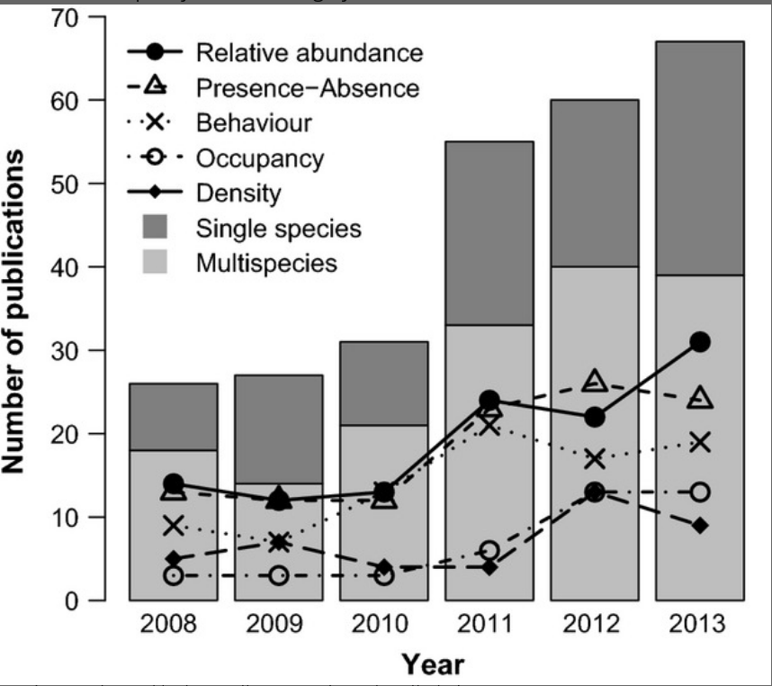

## Marked and unmarked species

For species in which individuals can be recognized from artificial or natural marks, capture-recapture models can be used to estimate abundance [@wearn2017].

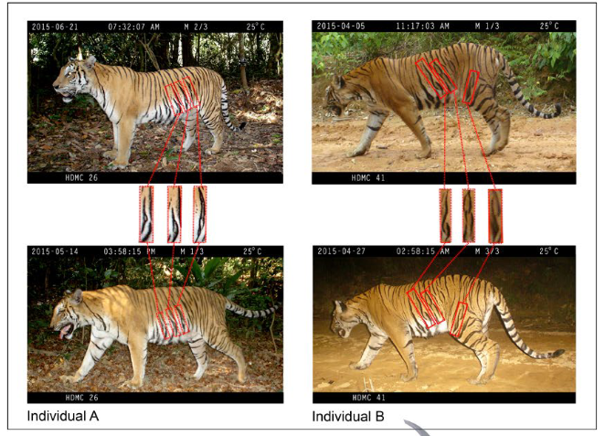

For species without recognizable individual markings, however, it may be difficult or impossible to identify individuals from photographs. Traditional capture-recapture approaches therefore cannot be applied directly.

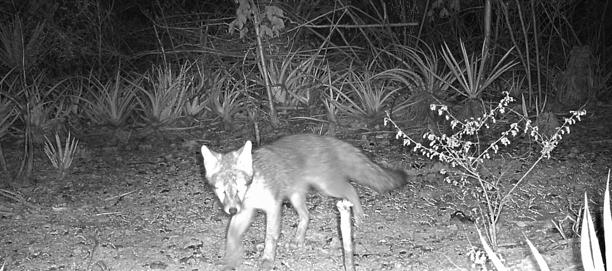

In these situations, researchers frequently use **indices** to make inferences about abundance [@oconnell2010; @obrien2003].

# The Relative Abundance Index

One of the most commonly used camera-trap indices is the number of photographic records standardized by camera-trap effort. This metric is commonly referred to as the **Relative Abundance Index (RAI)** and corresponds to RAI2 in @obrien2003.

$$
RAI = \frac{\text{Number of records}}{\text{camera-days}} \times 100
$$

Multiplying by 100 simply expresses the rate as records per 100 camera-days, which makes the value easier to communicate and compare.

## From RAI to abundance

Like any index, using RAI to make inferences about population abundance requires important assumptions.

In simplified form, these include:

1. photographic records should provide meaningful independent sampling information;
2. the population should be sufficiently closed during the sampling period; and
3. detection should not vary in ways that obscure the relationship between photographic rate and true abundance.

If those assumptions are reasonably satisfied, RAI may theoretically be correlated with true population abundance [@oconnell2010; @obrien2003].

## Independent records

Students are often told that only **independent records** should be used to calculate RAI. But what exactly does an independent record represent?

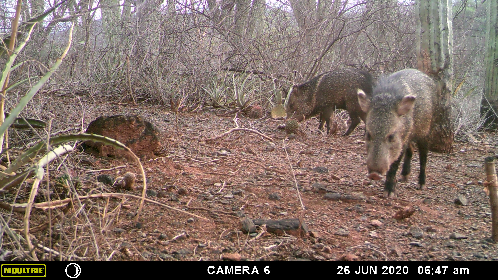

A common interpretation is that two records are independent when enough time has passed that they probably represent different individuals. This has led many camera-trap studies to use thresholds such as 30 minutes, 60 minutes, or even 24 hours [@sollmann2018].

There is an important conceptual problem with that interpretation: RAI is often used precisely because individuals **cannot** be recognized. We therefore cannot know whether an animal photographed after an arbitrary time threshold is a different individual.

A more useful interpretation is that temporal independence thresholds are used to reduce **temporal pseudoreplication**: repeated photographs that contain very similar information because they occur close together in time.

Choosing an interval is not trivial. A very short threshold may retain strongly dependent records, potentially inflating an index or violating assumptions of some statistical analyses [@carroll2000]. A very long interval can discard useful information, particularly for uncommon species.

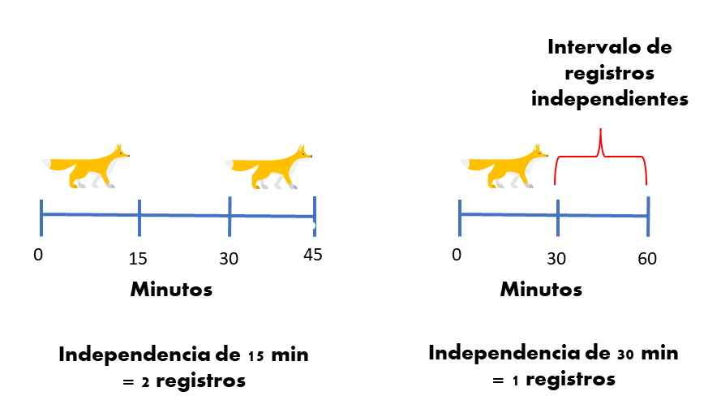

### Choosing an independence interval

There is no universally correct independence threshold.

Whenever possible, the interval should be selected using ecological knowledge of the target species and its movement behavior [@sollmann2018].

More formal approaches can include:

- exploring temporal autocorrelation among detections [@kays2014; @iannarilli2019];
- examining the distribution of time intervals between sequential records [@yasuda2004]; and
- explicitly evaluating the sensitivity of results to different thresholds.

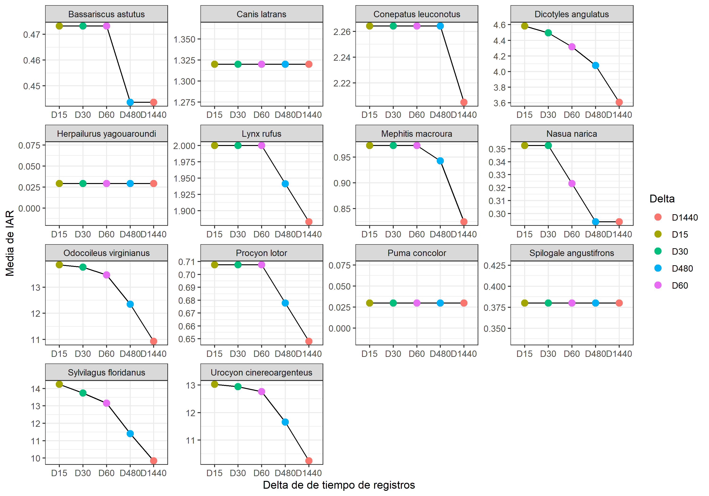

Formal approaches are still relatively uncommon, partly because data and accessible analytical tools are limited. The `lorelogram` approach described by @iannarilli2019 provides one promising option. Applications of this framework have suggested that temporal dependence may disappear after only a few minutes in many systems, although attractants can extend that interval [@iannarilli2021].

## Population closure

A closed population is ideally one in which births, deaths, immigration, and emigration do not change the number of individuals during the sampling period [@schoen1991].

This becomes important when an index is interpreted as a measure of abundance.

Imagine an exaggerated example in which a canid population declines each year over a three-year period. If all three years are treated as one sampling season, that decline may be obscured. If each year is analyzed separately, the change can become apparent.

The same problem can occur at the scale of months or biological seasons. The appropriate sampling period therefore depends on the ecological system and research question.

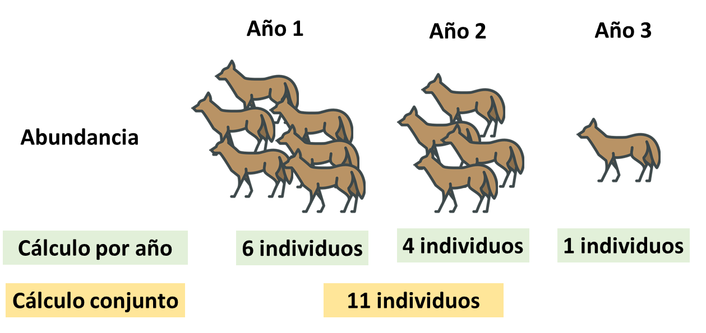

## Do we detect everything that is present?

Interpreting RAI as abundance implicitly assumes a strong relationship between the number of animals present and the number of photographic records obtained.

In the ideal case, changes in photographic rate would closely track changes in population abundance [@obrien2011].

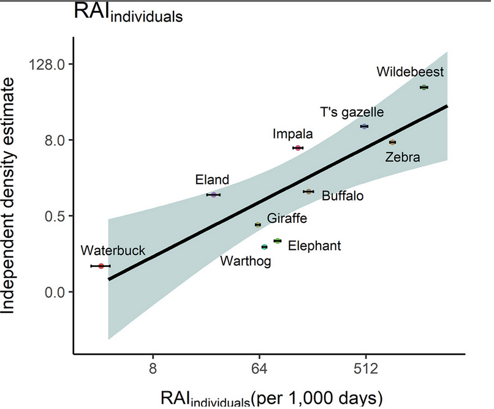

Under some circumstances, RAI can reflect abundance reasonably well [@palmer2018]. However, wildlife detection is rarely perfect [@kéry2009; @burton2015].

A species may be present at a site without being photographed during a particular sampling occasion. Failure to account for imperfect detection can therefore bias inference about the ecological parameter of interest [@martin-garcia2022].

[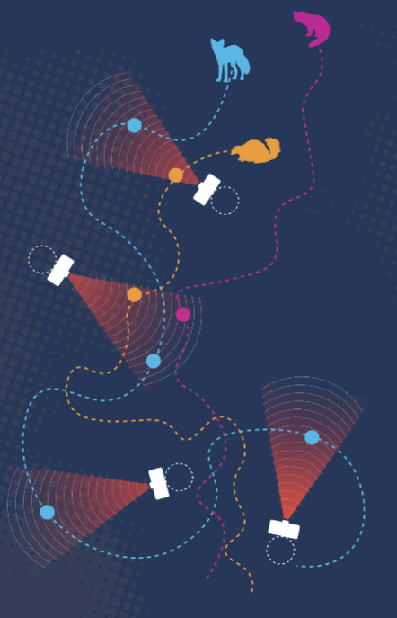{fig-align="left"}](https://www.researchgate.net/publication/344655192_Guia_Monitoreo_Escolar_Fauna_Silvestre_Fototrampeo_2019)

Camera traps have a relatively small effective sampling area [@andrade-ponce2021; @moeller2022]. An animal must move through the camera's detection zone and activate the sensor before it can be recorded.

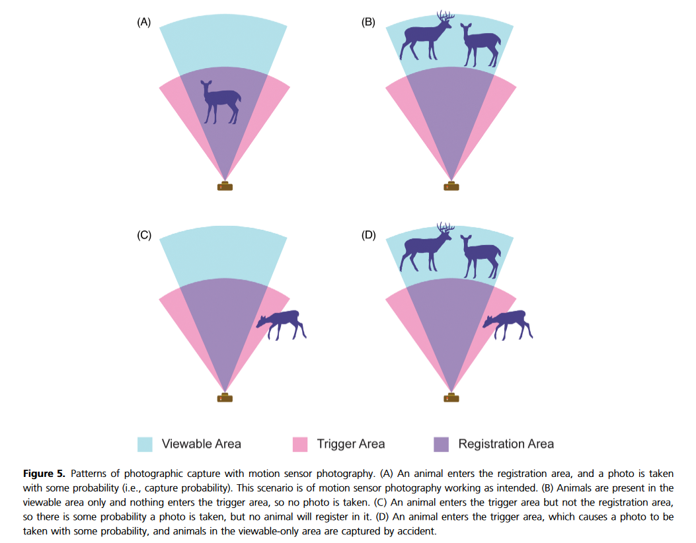

Detection probability can vary with many factors, including local abundance, home-range size, habitat, camera placement, movement behavior, and other species-specific characteristics [@burton2015; @andrade-ponce2021; @guillera-arroita2016].

Ignoring imperfect detection can even produce conclusions about abundance that differ from those obtained with methods that explicitly model detectability [@sollmann2013].

## Space use affects interpretation

Even if the previous assumptions were reasonably satisfied, habitat use and movement can still influence photographic rates [@stewart2018].

For example, species that move quickly through their home ranges may pass camera stations more often. Species with larger home ranges may encounter multiple stations, increasing their total number of detections [@broadley2019].

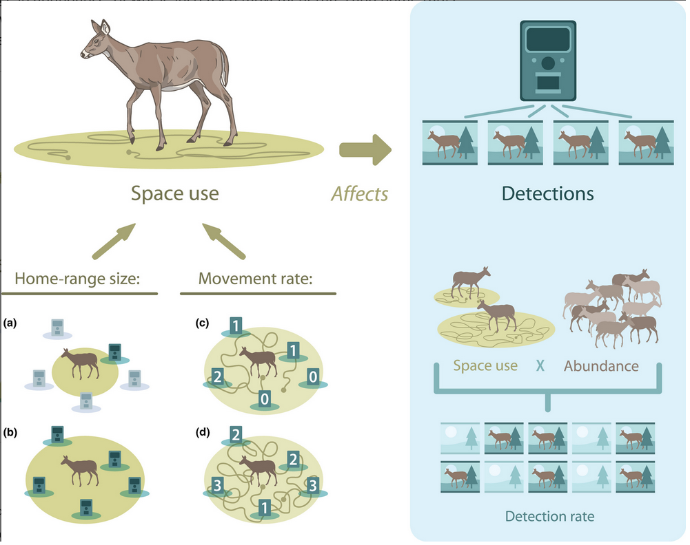{width="640"}

For this reason, a sensible use of photographic rates is often to interpret them as a measure of **activity or intensity of use**, rather than automatically treating them as direct estimates of abundance [@obrien2011].

This does not eliminate the problem of imperfect detection, but it avoids making a stronger population-level inference than the data can support.

# Conclusions

RAI remains widely used in camera-trap studies because it is intuitive and easy to calculate.

Its simplicity, however, should not be confused with an unbiased measure of abundance. Population inference based on RAI can be sensitive to violations of assumptions and to variation in detection processes [@gilbert2020].

RAI should therefore be interpreted cautiously when:

- making inferences about population abundance;
- comparing different study areas;
- comparing seasons with very different ecological conditions; or
- comparing species with different movement and detection processes [@anile2015; @iannarilli2021; @sollmann2013].

::: {.callout-tip}
### A useful way to think about RAI

In many camera-trap projects, it is more defensible to describe RAI as a **standardized photographic rate** or an index of **activity / intensity of use** and then evaluate how that rate changes with treatments, habitat, disturbance, or other covariates.
:::

Estimating abundance for unmarked species with camera traps can initially seem like an almost impossible problem. The important lesson is not that camera traps are inadequate, but that researchers need to be explicit about what their data can — and cannot — support.

A useful starting point for exploring stronger approaches to abundance estimation is @gilbert2020.

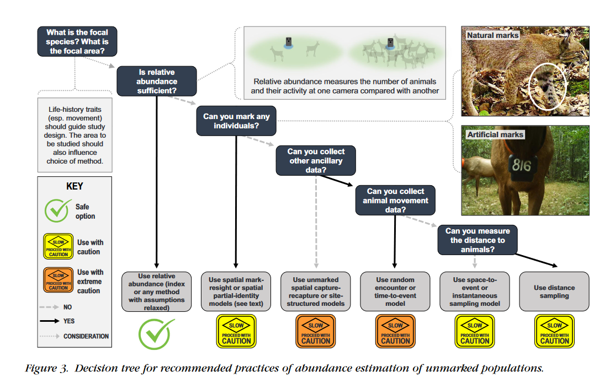
